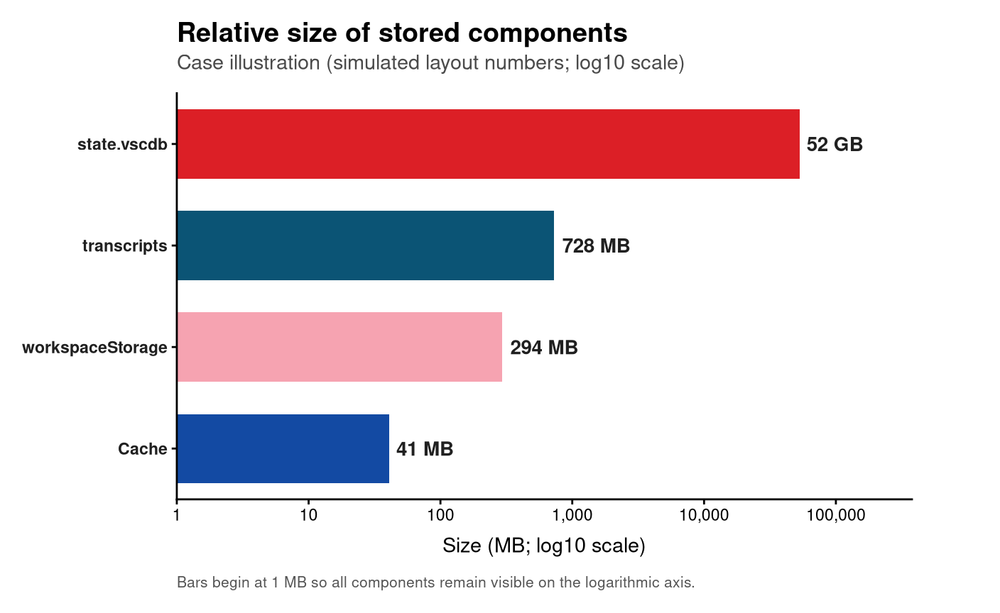
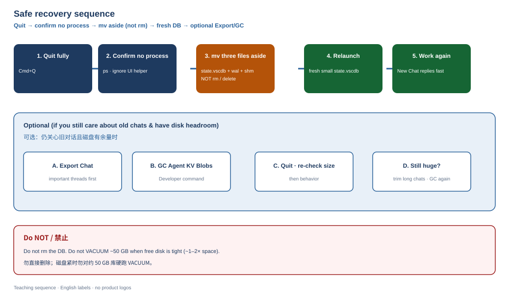

# How to: diagnose and recover (safely)

Use this guide to check the size of `state.vscdb`, get Cursor working again, and clean up safely. Why the symptoms look like a network fault is explained in [01-principles.md](01-principles.md); the full write-up is in [CASE_STUDY.md](CASE_STUDY.md); a longer command list is in [DIAGNOSTIC_COMMANDS.md](DIAGNOSTIC_COMMANDS.md).

The paths below are for macOS. On Linux the folder is `~/.config/Cursor/User/globalStorage/`; on Windows it is `%APPDATA%\Cursor\User\globalStorage\`.

## 0. Quit the IDE first (for moves / GC / VACUUM)

```bash
# Cmd+Q in the UI, then:
ps aux | grep -i "[C]ursor"
```

`CursorUIViewService` is a macOS service and can remain running. No other Cursor or Electron process should be left.

## 1. Read-only diagnose

None of these commands write to the database. The manual `sqlite3 -readonly` lines below can still create or update `state.vscdb-wal` / `state.vscdb-shm` because the Cursor database is in WAL mode; the script avoids that whenever possible (see the README).

```bash
cd /path/to/cursor-state-vscdb   # clone root
./scripts/diagnose.sh           # finds the file on macOS and Linux; elsewhere: CURSOR_STATE_DB=/path/state.vscdb ./scripts/diagnose.sh
# or:
du -h "$HOME/Library/Application Support/Cursor/User/globalStorage/state.vscdb"
sqlite3 -readonly "$HOME/Library/Application Support/Cursor/User/globalStorage/state.vscdb" \
  "SELECT COUNT(*) FROM cursorDiskKV;"
sqlite3 -readonly "$HOME/Library/Application Support/Cursor/User/globalStorage/state.vscdb" \
  "PRAGMA page_size; PRAGMA page_count; PRAGMA freelist_count;"
```

Rough size guide (a personal rule of thumb, not from Cursor):

| `state.vscdb` | Action |
|---------------|--------|
| &lt; 2 GB | Monitor |
| 2–10 GB | Export chats you need; consider GC; start new chats rather than growing a single thread indefinitely |
| 10–30 GB | Clean up soon; free disk space before compacting |
| &gt; 30 GB | Treat it as an incident; if Cursor is unusable, move the file aside (section 2) |

Figure: relative sizes in this case



[Source](../figures/charts/size-compare/) · also [KV row magnitudes](../figures/charts/kv-shape/preview.png)

## 2. Emergency: work again now (`mv`, never `rm`)

Quit Cursor first. These commands move `state.vscdb` into a new timestamped backup folder rather than deleting it, so Cursor starts with a fresh file. `mkdir` without `-p` aborts if that folder already exists, and `mv -n` never overwrites an existing file, so a second run cannot clobber an earlier backup. If the folder cannot be created, the commands say nothing was moved and return an error.

```bash
cd "$HOME/Library/Application Support/Cursor/User/globalStorage"
BACKUP="state-vscdb-backup-$(date +%Y%m%d-%H%M%S)"
if mkdir "$BACKUP"; then
  for f in state.vscdb state.vscdb-shm state.vscdb-wal; do
    if [ -e "$f" ]; then mv -n "$f" "$BACKUP"/; fi
  done
else
  echo "Could not create $BACKUP, so nothing was moved." >&2
  false
fi
```

Start Cursor, open a New Chat, and send `hello`. Keep the backup folder until you are certain you no longer need anything inside it.

Figure: recovery flow



[Source folder](../figures/schematic/recovery-flow/)

## 3. Prefer keeping history

```text
Quit → confirm agent-transcripts exist
  → Export Chat for anything precious
  → Developer: Delete Old Chats…   (staff order; untested locally here)
  → Command Palette: Developer: GC Agent KV Blobs
  → Quit again → re-run diagnose.sh (trust page_count)
```

What I measured: GC alone on the ~52 GB file ran for over an hour, the WAL file grew to roughly the size of the DB, free disk dropped to ~18 GiB, and only ~119 MiB was reclaimed. If the freelist is already small and most rows are still live, a second GC will not help.

If the file remains huge: export what you need, delete old chats or the few very long ones, run GC, and quit. That is safer than deleting rows with SQL and running `VACUUM`.

To inspect which row type consumes the most bytes (slow, optional; I have not run this on the 52 GB file, so the case study has no numbers for it):

```sql
SELECT
  CASE
    WHEN key LIKE 'bubbleId:%' THEN 'bubbleId'
    WHEN key LIKE 'agentKv:%' THEN 'agentKv'
    WHEN key LIKE 'checkpointId:%' THEN 'checkpointId'
    ELSE 'other'
  END AS kind,
  COUNT(*) AS n,
  SUM(length(value)) AS bytes
FROM cursorDiskKV
GROUP BY 1
ORDER BY bytes DESC;
```

## 4. Do not start here

Do not start with this. Users report losing chats this way.

```sql
DELETE FROM cursorDiskKV WHERE key LIKE 'agentKv:%';
-- ...
VACUUM;
```

Only consider it once you have a backup and know what data will be lost.

## 5. Free disk before compact

You need free disk space roughly equal to the size of the DB, and up to twice that to be safe. In this case the WAL during GC reached about the size of `state.vscdb` (~52 GB) and free disk fell to ~18 GiB. If the disk fills up midway through a compact, recovery becomes much harder.

## 6. Redact secrets

`ps` output can expose `--api-key` values. Do not paste raw process lists on GitHub, Reddit, or forums.

## Forum peers

Similar reports and Cursor staff replies: [RELATED.md](RELATED.md) (Cursor Community Forum section).
